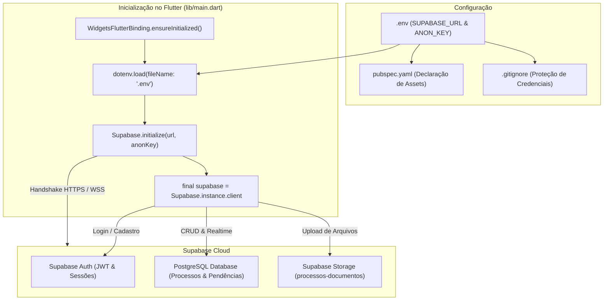

# Integração e Conexão com o Supabase — EcoGestão

Este documento detalha tecnicamente como foi planejada, configurada e validada a conexão entre o aplicativo **Flutter** e o backend **Supabase (PostgreSQL + Auth + Storage)** no projeto EcoGestão.

---

## 1. Visão Geral da Conexão

O Supabase atua como o backend como serviço (BaaS) central do sistema, provendo:
- **Banco de Dados PostgreSQL**: Armazena as tabelas relacionais do sistema (`profiles`, `processos`, `pendencias`, `documentos`, `historico_movimentacoes`, etc.).
- **Supabase Auth**: Gerencia login, cadastro de clientes/consultores e sessões seguras com tokens JWT.
- **Supabase Storage**: Armazena PDFs e imagens de protocolos e comprovações no bucket `processos-documentos`.
- **Row Level Security (RLS)**: Regras de segurança a nível de linha para garantir isolamento de dados entre clientes.

---

## 2. Diagrama da Arquitetura de Conexão



---

## 3. Passo a Passo da Implementação

### Passo 1: Configuração e Proteção das Credenciais no `.env`
As credenciais extraídas do painel administrativo do Supabase (*Project Settings → API*) foram organizadas no arquivo `.env` na raiz do projeto:

```env

```

- **`SUPABASE_URL`**: URL da instância em nuvem do projeto.
- **`SUPABASE_ANON_KEY`**: Chave de acesso pública (*anon/public*), segura para uso no cliente, pois o acesso a dados sensíveis é protegido pelo Row Level Security (RLS) no PostgreSQL.
- **Segurança**: A regra `.env` foi inserida no `.gitignore` para impedir que essas chaves sejam enviadas para repositórios Git públicos.

---

### Passo 2: Registro do `.env` nos Assets do Flutter (`pubspec.yaml`)
Por padrão, o Flutter não empacota arquivos da raiz dentro do executável compilado a menos que sejam explicitamente listados na seção `flutter.assets`:

```yaml
flutter:
  uses-material-design: true

  assets:
    - .env
```

---

### Passo 3: Instalação do SDK Oficial (`supabase_flutter`)
Foi adicionado ao `pubspec.yaml` o pacote oficial mantido pela equipe do Supabase:

```yaml
dependencies:
  flutter:
    sdk: flutter
  supabase_flutter: ^2.18.3
  flutter_dotenv: ^6.0.2
```

O SDK `supabase_flutter` gerencia de forma transparente:
1. **HTTP/REST (PostgREST)**: Traduz chamadas Dart para requisições REST otimizadas no PostgreSQL.
2. **Persistência de Sessão**: Armazena tokens JWT e dados do usuário logado localmente (via `SharedPreferences`), mantendo o usuário conectado mesmo após fechar o app.
3. **WebSockets (Realtime)**: Permite escutar atualizações em tabelas em tempo real.
4. **Storage API**: Facilita uploads multipart/form-data e downloads com URLs assinadas.

---

### Passo 4: Ciclo de Inicialização no `lib/main.dart`
O ponto de entrada do app executa o ciclo de inicialização assíncrono antes de renderizar qualquer componente na tela:

```dart
import 'package:flutter/material.dart';
import 'package:flutter_dotenv/flutter_dotenv.dart';
import 'package:supabase_flutter/supabase_flutter.dart';
import 'core/theme/app_theme.dart';

Future<void> main() async {
  // 1. Garante a prontidão da ponte entre o Flutter Engine e o código nativo
  WidgetsFlutterBinding.ensureInitialized();

  // 2. Lê e processa o arquivo .env
  await dotenv.load(fileName: ".env");

  final supabaseUrl = dotenv.env['SUPABASE_URL'];
  final supabaseAnonKey = dotenv.env['SUPABASE_ANON_KEY'];

  if (supabaseUrl == null || supabaseAnonKey == null) {
    throw Exception('Credenciais do Supabase não encontradas no arquivo .env');
  }

  // 3. Inicializa o cliente do Supabase
  await Supabase.initialize(
    url: supabaseUrl,
    anonKey: supabaseAnonKey,
  );

  runApp(const EcoGestaoApp());
}

// 4. Atalho global para acesso facilitado em qualquer arquivo do app
final supabase = Supabase.instance.client;
```

---

## 4. Como o Cliente Global é Usado nas Telas e Serviços

Com o atalho `final supabase = Supabase.instance.client;`, qualquer arquivo do projeto pode interagir com o backend de forma simples e declarativa:

### Autenticação (Login e Cadastro):
```dart
// Cadastro de novo usuário
final authResponse = await supabase.auth.signUp(
  email: 'usuario@email.com',
  password: 'senhaSegura123',
);

// Login de usuário existente
final session = await supabase.auth.signInWithPassword(
  email: 'usuario@email.com',
  password: 'senhaSegura123',
);

// Obter usuário logado atual
final usuarioAtual = supabase.auth.currentUser;

// Logout
await supabase.auth.signOut();
```

### Consultas e Gravação no Banco (PostgreSQL):
```dart
// Buscar todos os processos do usuário logado
final processos = await supabase
    .from('processos')
    .select('*, orgaos_ambientais(sigla, nome)')
    .eq('user_id', supabase.auth.currentUser!.id)
    .order('created_at', ascending: false);

// Inserir um novo processo
await supabase.from('processos').insert({
  'user_id': supabase.auth.currentUser!.id,
  'orgao_id': orgaoSelecionadoId,
  'empreendimento': 'Fazenda Primavera',
  'numero_protocolo': '2026/001452',
  'tipo_licenca': 'Licença Prévia (LP)',
  'status': 'em_analise',
});
```

### Upload de Documentos para o Storage:
```dart
// Enviar PDF para o bucket 'processos-documentos'
final storagePath = '${supabase.auth.currentUser!.id}/processo_${processoId}.pdf';

await supabase.storage.from('processos-documentos').uploadBinary(
  storagePath,
  arquivoBytes,
  fileOptions: const FileOptions(contentType: 'application/pdf'),
);
```

---

## 5. Teste Prático de Validação em Linha de Comando

Para verificar a integridade da conexão fora da interface gráfica, foi executado um script de teste via PowerShell consumindo diretamente a API REST do Supabase com os cabeçalhos de autenticação:

```powershell
$env = Get-Content C:\eco_gestao\.env | ConvertFrom-StringData
$url = "$($env.SUPABASE_URL)/rest/v1/orgaos_ambientais?select=*"
$headers = @{
    "apikey" = $env.SUPABASE_ANON_KEY
    "Authorization" = "Bearer $($env.SUPABASE_ANON_KEY)"
}
Invoke-RestMethod -Uri $url -Headers $headers -Method Get
```

**Resultado:**
- **Status HTTP:** `200 OK` (Comunicação estabelecida com sucesso).
- **Endpoint verificado:** A tabela `orgaos_ambientais` respondeu adequadamente, confirmando que o schema SQL foi criado no banco e o token público tem autorização para consulta.

---

## 6. Próximas Recomendações para a Base de Dados

Caso ainda não tenham sido inseridos os órgãos ambientais padrão no Supabase, execute o trecho abaixo no **SQL Editor** do painel do Supabase:

```sql
insert into public.orgaos_ambientais (sigla, nome, esfera) values
('NATURATINS', 'Instituto Natureza do Tocantins', 'Estadual'),
('IBAMA', 'Instituto Brasileiro do Meio Ambiente e dos Recursos Naturais Renováveis', 'Federal'),
('SEDEMA', 'Secretaria Municipal de Meio Ambiente', 'Municipal'),
('SEMAD', 'Secretaria de Estado de Meio Ambiente e Desenvolvimento Sustentável', 'Estadual')
on conflict (sigla) do nothing;
```
