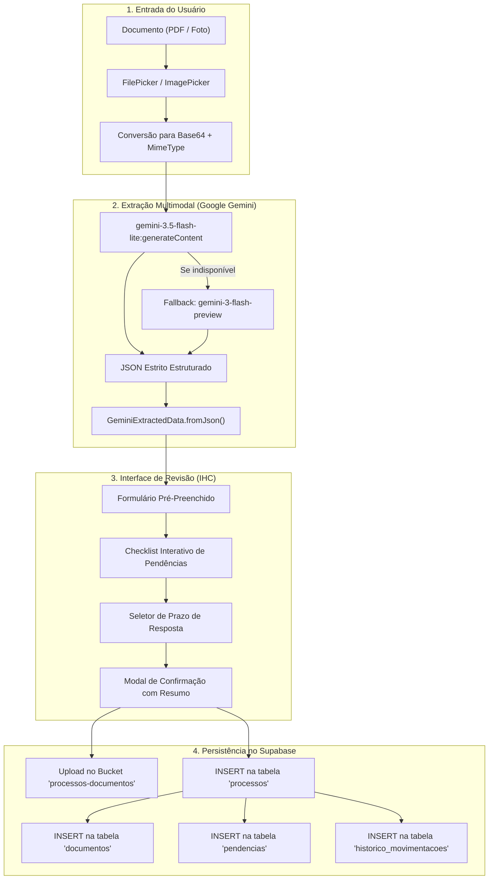

# Relatório Técnico do Módulo de OCR com Google Gemini ("Adicionar Processo")

Este documento detalha a implementação completa do **Item 5 do roteiro de desenvolvimento** ([PassoaPasso.txt](file:///C:/eco_gestao/PassoaPasso.txt)): **Extração inteligente de processos ambientais via OCR Multimodal com Google Gemini, revisão interativa de pendências pelo usuário e persistência relacional no Supabase (Database + Storage)**.

---

## 1. Visão Geral e Propósito

No ecossistema de consultoria ambiental do **EcoGestão**, a entrada manual de processos é propensa a erros de digitação e consome tempo precioso. O módulo de **OCR com IA** resolve esse gargalo:

1. O consultor ou cliente submete uma cópia em **PDF** ou **foto/imagem** da notificação, licença ou ofício do órgão ambiental (NATURATINS, IBAMA, SEDEMA, SEMAD).
2. A API multimodal do **Google Gemini** analisa o documento e extrai dados cadastrais de forma estruturada: protocolo, empreendimento, órgão emissor, modalidade da licença e todas as pendências e exigências técnicas listadas.
3. Os dados são apresentados na tela em uma interface interativa: o usuário pode **conferir, editar textos, desmarcar pendências irrelevantes ou adicionar novas pendências**.
4. Após confirmação expressa do usuário, o sistema realiza a **orquestração de salvamento completo** no Supabase: grava o arquivo físico no **Storage**, cria o processo, vincula as pendências ativas e gera o evento inicial na linha do tempo do histórico.

---

## 2. Fluxo da Arquitetura do Pipeline



---

## 3. Resolução da Conexão com o Gemini (Erro 404 e Modelos Ativos)

### 3.1. Diagnóstico do Erro 404
Durante os primeiros testes com o endpoint `gemini-2.5-flash` e o fallback `gemini-1.5-flash`, a API do Google retornou:
> `Failed to load resource: the server responded with a status of 404 ()`

A investigação técnica comprovou que a Google **descontinuou o acesso a esses modelos para novas chaves/contas**:
- `gemini-2.5-flash`: **404 Not Found** (*"This model is no longer available to new users. Please update your code to use models/gemini-3.x"*).
- `gemini-1.5-flash`: **404 Not Found** (descontinuado).

### 3.2. Benchmarks e Seleção da Família Gemini 3.x
Testes de chamada direta à API REST `v1beta` utilizando a chave do projeto validaram os modelos disponíveis:

| Modelo | Latência Média | Status do Teste | Papel no EcoGestão |
| :--- | :--- | :--- | :--- |
| **`gemini-3.5-flash-lite`** | **~1.09s** | **200 OK (JSON Válido)** | **Modelo Primário (Padrão)** |
| **`gemini-3-flash-preview`** | **~2.02s** | **200 OK (JSON Válido)** | **Modelo Fallback (Contingência)** |
| `gemini-3.5-flash` | Variável | 503 temporário esporádico | Não utilizado |
| `gemini-2.5-flash` | — | 404 Descontinuado | Removido |
| `gemini-1.5-flash` | — | 404 Descontinuado | Removido |

---

## 4. Estrutura dos Componentes e Código-Fonte

O módulo foi estruturado dentro da arquitetura limpa em `lib/features/ocr/`:

```
lib/features/ocr/
├── models/
│   └── gemini_extracted_data.dart      # DTO e serialização do schema JSON retornado pela IA
├── services/
│   └── gemini_ocr_service.dart         # Comunicação HTTP REST direta com a API do Gemini
├── data/
│   └── ocr_pipeline_service.dart       # Orquestração do salvamento no Supabase (Storage + DB)
└── presentation/
    └── screens/
        └── novo_processo_ocr_screen.dart # Tela completa com upload, checklist e confirmação
```

---

### 4.1. Modelo de Dados da IA ([gemini_extracted_data.dart](file:///C:/eco_gestao/lib/features/ocr/models/gemini_extracted_data.dart))

Define o contrato estrito de dados retornados pela IA multimodal:

```dart
class GeminiExtractedData {
  final String numeroProtocolo;
  final String empreendimento;
  final String orgao;
  final String tipoLicenca;
  final String statusSugerido;
  final String? resumoAndamento;
  final String? dataProtocolo;
  final String? dataLimiteResposta;
  final List<PendenciaExtraida> pendenciasIdentificadas;
  final Map<String, dynamic>? historicoEvento;
  // ...
}
```

---

### 4.2. Serviço de Integração Multimodal ([gemini_ocr_service.dart](file:///C:/eco_gestao/lib/features/ocr/services/gemini_ocr_service.dart))

- **Comunicação REST Pura:** Utiliza `package:http` com `v1beta/models/gemini-3.5-flash-lite:generateContent?key=$apiKey`.
- **Payload Multimodal com `inline_data`:** Envia o documento em Base64 especificando o `mime_type` (`application/pdf`, `image/png`, `image/jpeg`).
- **Configuração de Geração Estrita:** 
  - `response_mime_type: 'application/json'`
  - `temperature: 0.1` (alta fidelidade e mínima alucinação para documentos jurídicos e técnicos).
- **Sanitização de Código (`_cleanJsonString`):** Remove blocos ````json ```` caso a IA inclua delimitadores markdown no texto.
- **Mecanismo de Tolerância a Falhas:** Caso o endpoint principal falhe, o serviço automaticamente encaminha o payload para `gemini-3-flash-preview`.

---

### 4.3. Pipeline de Persistência no Supabase ([ocr_pipeline_service.dart](file:///C:/eco_gestao/lib/features/ocr/data/ocr_pipeline_service.dart))

Orquestra atomicamente as operações no backend:

1. **Upload no Supabase Storage:**
   - Bucket: `processos-documentos`.
   - Caminho: `{userId}/{timestamp}_{nome_higienizado}.pdf`.
   - Utiliza `uploadBinary` com `FileOptions(contentType: mimeType, upsert: true)`.
2. **Inserção na Tabela `processos`:**
   - Grava `user_id`, `orgao_id`, `empreendimento`, `numero_protocolo`, `tipo_licenca`, `status`, `data_protocolo` e `observacoes`.
3. **Inserção na Tabela `documentos`:**
   - Vincula ao `processo_id` recém-criado, registrando o `storage_path`, `tamanho_bytes`, `ocr_status = 'concluido'` e o payload completo no campo `ocr_dados_extraidos (JSONB)`.
4. **Inserção na Tabela `pendencias`:**
   - Itera sobre as pendências que o usuário manteve **selecionadas** no checklist, gravando `titulo`, `descricao`, `status = 'pendente'` e `data_limite` (prazo formatado).
5. **Inserção na Tabela `historico_movimentacoes`:**
   - Adiciona o marco inicial da linha do tempo: `"Entrada e Leitura do Documento (IA)"` com a contagem de pendências registradas.

---

### 4.4. Tela Interativa com o Usuário ([novo_processo_ocr_screen.dart](file:///C:/eco_gestao/lib/features/ocr/presentation/screens/novo_processo_ocr_screen.dart))

Desenvolvida com foco em **Interação Humano-Computador (IHC)** e princípios de transparência da IA:

- **Seletor Duplo:** Botões para escolher documento via explorador de arquivos (PDF) ou fotos/câmera (JPEG/PNG).
- **Card de Documento Selecionado:** Mostra o ícone representativo (PDF ou Imagem), nome do arquivo e tamanho em KB, com botão para substituir.
- **Feedback Visual de Processamento:** Indicador de progresso animado com mensagem informativa durante os ~1 a 2 segundos de análise pela IA.
- **Formulário Dinâmico:** Preenchimento instantâneo de Protocolo, Empreendimento, Dropdown de Órgão Ambiental e Tipo de Licença.
- **Checklist Interativo de Pendências:**
  - Cada pendência identificada pelo Gemini aparece em um cartão individual com **Checkbox de ativação**.
  - O usuário pode **editar o título e a descrição** caso queira complementar a redação técnica do órgão.
  - Botão de **lixeira** para descartar itens falsos-positivos.
  - Botão **"+ Adicionar outra pendência"** para inclusão de exigências não listadas no documento.
- **Seletor de Prazo:** Botão com calendário para definir a data limite de resposta às pendências.
- **Modal de Confirmação Final:** Exibe um resumo estruturado antes do disparo das gravações, evitando cadastros acidentais.

---

## 5. Relação com as Telas do Projeto (Conformidade IHC)

| Tela IHC | Papel no Fluxo do OCR |
| :--- | :--- |
| **Tela 02 — Home / Dashboard** | Atualiza os contadores de "Processos em Andamento" e "Pendências Ativas" assim que o processo cadastrado via OCR é salvo. |
| **Tela 03 — Listagem de Processos** | O botão de topo **`+ Adicionar processo`** aciona diretamente a tela [novo_processo_ocr_screen.dart](file:///C:/eco_gestao/lib/features/ocr/presentation/screens/novo_processo_ocr_screen.dart) e recarrega a lista automaticamente no retorno (`onPop`). |
| **Tela 04 — Detalhes do Processo (Próximo Passo)** | Exibirá o histórico e os documentos gravados pelo pipeline de OCR, permitindo download e visualização da cópia enviada ao Storage. |
| **Tela 05 — Pendências (Próximo Passo)** | Listará as pendências que foram ativadas no checklist do OCR para envio de comprovantes de saneamento. |

---

## 6. Procedimento de Teste e Validação

1. Inicie a aplicação no Chrome:
   ```bash
   flutter run -d chrome
   ```
2. Na barra inferior, clique na aba **Processos**.
3. Clique no botão verde **`+ Adicionar processo`**.
4. Clique em **"Selecionar PDF ou Foto"** e escolha um arquivo (ex: notificação ambiental, comprovante ou licença).
5. Verifique a extração em tempo real:
   - Os campos de protocolo, empreendimento e órgão são preenchidos.
   - O checklist de pendências lista as notificações encontradas.
6. Edite qualquer pendência ou defina a data limite.
7. Clique em **"Revisar e Salvar Processo"** e confirme no diálogo modal.
8. Verifique o alerta verde de sucesso e a inserção imediata do novo processo na lista principal da **Tela 03**.
