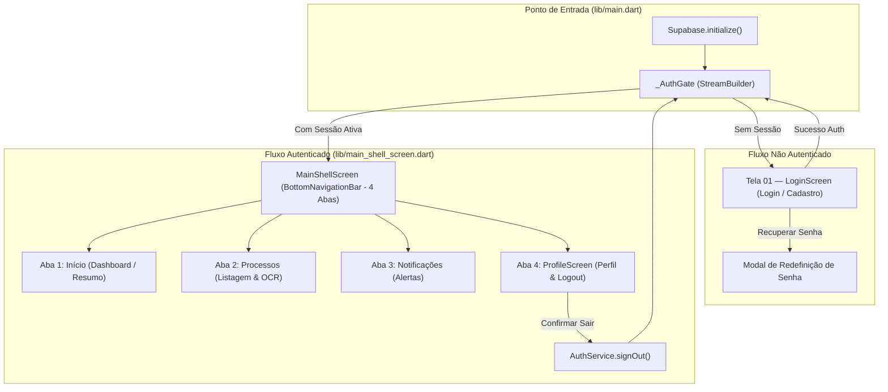

# Relatório Técnico de Telas e Navegação — EcoGestão

Este relatório analisa detalhadamente as alterações introduzidas no último commit do projeto (**`17e7b2f` — "Criação tela screen, home"**), cobrindo a arquitetura das telas implementadas, o fluxo de navegação, a autenticação integrada com o **Supabase Auth** e a conformidade com as 5 Telas de IHC planejadas.

---

## 1. Metadados do Commit Analisado

- **Hash:** `17e7b2fb1254232559e039c7d405bcb6b38504b3`
- **Mensagem:** `Criação tela screen, home`
- **Autor:** `Sousatutu <arthur.compimax@gmail.com>`
- **Data:** `14/11/2026 16:24:28 -03:00`
- **Estatísticas:** 10 arquivos alterados / criados (+1.363 inserções, -137 remoções).
- **Validação de Código:** `flutter analyze` executado com sucesso (**0 erros, 0 warnings**).

---

## 2. Visão Geral da Arquitetura de Telas e Fluxo do App

---

## 3. Análise Detalhada dos Arquivos e Telas Criadas

### 3.1. Tela 01 — Login e Cadastro (`lib/features/auth/presentation/screens/login_screen.dart`)
- **Linhas de Código:** 533 linhas.
- **Objetivo:** Fornecer a porta de entrada única para clientes e consultores acessarem o Portal EcoGestão.
- **Componentes e Recursos Implementados:**
  1. **Alternância Suave de Modo:** Um único formulário que alterna dinamicamente entre **"Entrar"** e **"Criar Conta"** sem troca brusca de rotas.
  2. **Campos do Formulário:**
     - *Nome Completo* (exibido apenas no modo de cadastro, com validação de preenchimento).
     - *E-mail* (com validação de formato e regex).
     - *Senha* (mínimo de 6 caracteres, com botão para alternar visibilidade / esconder texto).
     - *Confirmação de Senha* (no modo cadastro, com validação de igualdade estrita).
  3. **Recuperação de Senha:** Modal integrado via `showDialog` para disparo de e-mail de redefinição de senha com `authService.sendPasswordReset()`.
  4. **Feedback Visual:** Exibição de `CircularProgressIndicator` em estados de carregamento e `SnackBar` estilizado para mensagens de sucesso ou advertência.
  5. **Design Responsivo:** `SingleChildScrollView` com `ConstrainedBox` centralizando o cartão em telas maiores (Web/Desktop) com largura máxima de 440px.

---

### 3.2. Serviço de Autenticação (`lib/features/auth/data/auth_service.dart`)
- **Linhas de Código:** 129 linhas.
- **Objetivo:** Isolar as regras de negócio de autenticação e comunicação direta com a API do Supabase.
- **Recursos Chave:**
  - `signIn(email, password)`: Realiza a autenticação e invoca `ensureProfile`.
  - `signUp(fullName, email, password)`: Cria o usuário no Supabase Auth salvando o `nome_completo` nos metadados. Retorna se a conta exige confirmação por e-mail (`SignUpResult.requiresEmailConfirmation`).
  - `ensureProfile(user)`: **Ponto crítico de integridade relacional**. Garante que, ao criar ou logar um usuário, exista um registro correspondente na tabela `public.profiles` (`id`, `nome_completo`, `role: 'cliente'`). Isso previne falhas de chave estrangeira (FK) ao cadastrar processos posteriormente.
  - `mapErrorMessage(error)`: Traduz códigos e mensagens técnicas em inglês da `AuthException` do Supabase para português claro e amigável (ex: *"E-mail ou senha incorretos"*, *"A senha deve ter pelo menos 6 caracteres"*).

---

### 3.3. Shell Principal de Navegação (`lib/features/navigation/presentation/screens/main_shell_screen.dart`)
- **Linhas de Código:** 186 linhas.
- **Objetivo:** Estrutura mestre da aplicação após o login, hospedando a barra inferior de navegação.
- **Estrutura das 4 Abas:**
  1. **Aba 1 — Início (Home):** Atualmente implementada com placeholder temático guiando a criação da futura Tela 02 (cards de processos, métricas e notificações).
  2. **Aba 2 — Processos:** Placeholder temático preparando a recepção da Tela 03 (listagem completa, filtros por órgão ambiental e botão de OCR com Gemini).
  3. **Aba 3 — Notificações:** Placeholder com ícone de alerta para monitoramento de prazos e comunicados de órgãos reguladores.
  4. **Aba 4 — Perfil (`ProfileScreen`):** Tela interativa de gerenciamento da conta.
- **Destaques Técnicos:**
  - Uso de `IndexedStack`: Mantém todas as abas vivas na memória, preservando scroll e dados quando o usuário alterna de aba.
  - AppBar padronizada com o logotipo compacto [EcoBrandLogo](file:///C:/eco_gestao/lib/core/widgets/eco_brand_logo.dart).
  - Divisória sutil inferior com borda `#E5E7EB`.

---

### 3.4. Tela de Perfil e Sessão (`lib/features/profile/presentation/screens/profile_screen.dart`)
- **Linhas de Código:** 153 linhas.
- **Objetivo:** Exibir dados cadastrais do cliente logado e oferecer encerramento seguro de sessão.
- **Componentes:**
  - Cartão de cabeçalho com `CircleAvatar` exibindo a inicial do usuário em fundo verde claro (`#E8F3EA`).
  - Nome completo e e-mail extraídos do `currentUser` do Supabase.
  - Badge visual indicando a função (*Role: "Cliente"*).
  - Informações institucionais da consultoria ambiental.
  - Botão vermelho de **"Sair da Conta"** com diálogo modal de confirmação (`AlertDialog`) para evitar toques acidentais.

---

### 3.5. Componente de Branding (`lib/core/widgets/eco_brand_logo.dart`)
- **Linhas de Código:** 65 linhas.
- **Objetivo:** Padronização visual da marca EcoGestão em todo o aplicativo.
- **Visual:**
  - Ícone arredondado `Icons.eco_rounded` na cor verde escuro institucional (`#176B3A`).
  - Título `EcoGestão` na fonte **Poppins Bold** (tamanho customizável).
  - Subtítulo opcional *"CONSULTORIA E GESTÃO AMBIENTAL"* em fonte **Inter** com espaçamento entre letras (letter-spacing: 0.9).

---

### 3.6. Orquestração Reativa no `lib/main.dart`
- **Linhas de Código:** 75 linhas.
- **Melhoria Arquitetural:**
  - O widget `_AuthGate` utiliza um `StreamBuilder<AuthState>` escutando `supabaseClient.auth.onAuthStateChange`.
  - **Fluxo Reativo Sem Rotas Manuais:** Quando o usuário efetua login ou logout, o `StreamBuilder` detecta a mudança de estado e comuta instantaneamente entre `LoginScreen` e `MainShellScreen`, eliminando necessidade de `Navigator.pushReplacementNamed` espalhados pelo código.

---

## 4. Comparativo: IHC 5 Telas vs. Implementação Atual

| Tela Planejada no IHC | Nome da Tela | Status Atual | Arquivo Principal |
| :--- | :--- | :---: | :--- |
| **Tela 01** | Cadastro e Login | ✅ **100% Concluída** | `lib/features/auth/presentation/screens/login_screen.dart` |
| **Menu Inferior** | Navegação Principal (4 abas) | ✅ **100% Concluído** | `lib/features/navigation/presentation/screens/main_shell_screen.dart` |
| **Aba Perfil** | Dados da Conta & Logout | ✅ **100% Concluída** | `lib/features/profile/presentation/screens/profile_screen.dart` |
| **Tela 02** | Home / Dashboard com Cards | ✅ **100% Concluída** | `lib/features/home/presentation/screens/home_screen.dart` |
| **Tela 03** | Listagem de Processos | ✅ **100% Concluída** | `lib/features/processos/presentation/screens/processos_list_screen.dart` |
| **Módulo OCR** | Adicionar Processo via IA | ⏳ *Próxima etapa* | `lib/features/ocr/services/gemini_ocr_service.dart` |
| **Tela 04** | Detalhes do Processo (Timeline) | ⏳ *Pendente* | `lib/features/processos/presentation/screens/processo_detalhes_screen.dart` |
| **Tela 05** | Pendências & Envio de Documentos | ⏳ *Pendente* | `lib/features/pendencias/presentation/screens/pendencias_screen.dart` |

---

## 5. Implementação das Telas 02 e 03 (Item 4 do Passo a Passo)

### 5.1. Tela 02 — Home / Início (`lib/features/home/presentation/screens/home_screen.dart`)
- **Saudação Personalizada:** Exibe "Olá, {Nome}! Bem-vindo." com o primeiro nome extraído do perfil logado.
- **Grid de 4 Contadores de Status:**
  - `Em andamento` (Ícone de pasta, cor azul `#2563EB`).
  - `Em análise` (Ícone de relógio, cor âmbar `#D97706`).
  - `Com pendências` (Ícone de alerta, cor vermelha `#DC2626`).
  - `Licenças emitidas` (Ícone de check, cor verde `#16A34A`).
- **Seção "Acompanhe seus processos":** Cards estilizados dos processos mais recentes com badge colorida de status e atalho "Ver todos os processos" que comuta a aba ativa para a listagem.
- **Seção "Notificações recentes":** Alerta destacado sobre pendências documentais.

### 5.2. Tela 03 — Processos (`lib/features/processos/presentation/screens/processos_list_screen.dart`)
- **Busca em Tempo Real:** Campo de busca textual por empreendimento, número de protocolo ou sigla do órgão.
- **Filtros Combinados:**
  - Dropdown por Órgão Ambiental (`NATURATINS`, `IBAMA`, `SEDEMA`, `SEMAD`, ou todos).
  - Dropdown por Status (`Em andamento`, `Em análise`, `Com pendência`, `Licença emitida`, `Arquivado`).
  - Botão interativo para "Limpar filtros" quando ativos.
- **Contador Dinâmico:** Exibe `X processos cadastrados`.
- **Botão "+ Adicionar processo":** Abre modal bottom-sheet completo para cadastrar novos processos diretamente no Supabase.
- **Card Padronizado (`ProcessoCard`):** Exibe empreendimento, protocolo, órgão, tipo de licença e badge com status.

---

## 6. Próximos Passos de Desenvolvimento

1. **Item 5 do Passo a Passo — OCR com Gemini ("Adicionar Processo com IA")**:
   - Integrar upload de PDF/imagem via `file_picker` / `image_picker`.
   - Envio para a API multimodal do Google Gemini (`gemini-2.5-flash`).
   - Extração automática de protocolo, empreendimento, órgão e pendências.
   - Pré-preenchimento do formulário de cadastro para validação do usuário antes de persistir no Supabase + Storage.
2. **Item 6 do Passo a Passo — Telas 04 e 05 (Detalhes e Pendências)**:
   - Linha do tempo de movimentações e envio de documentos para sanar pendências.
